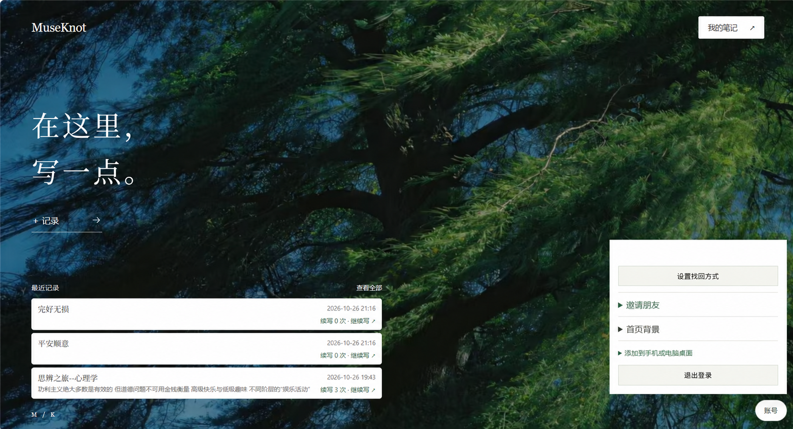
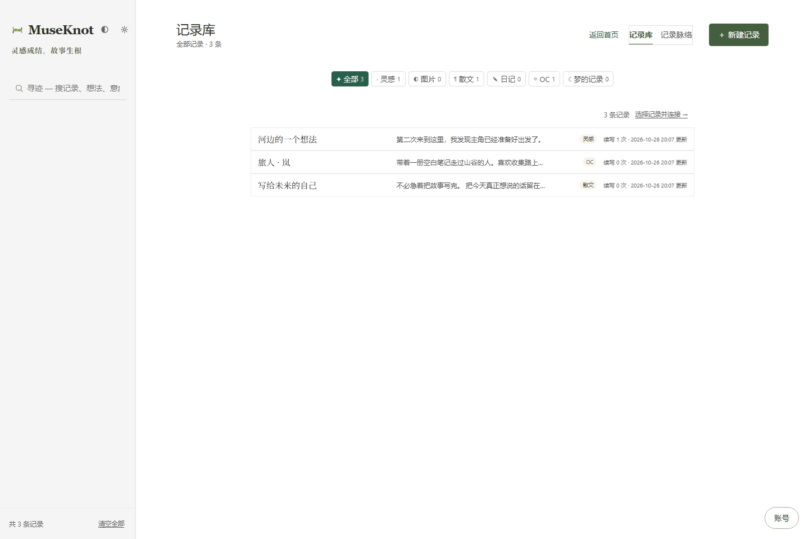
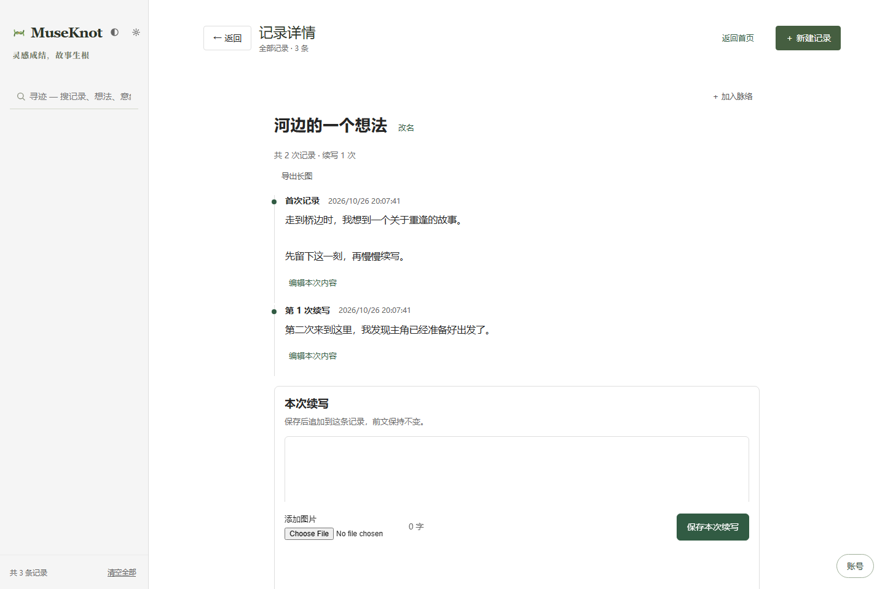
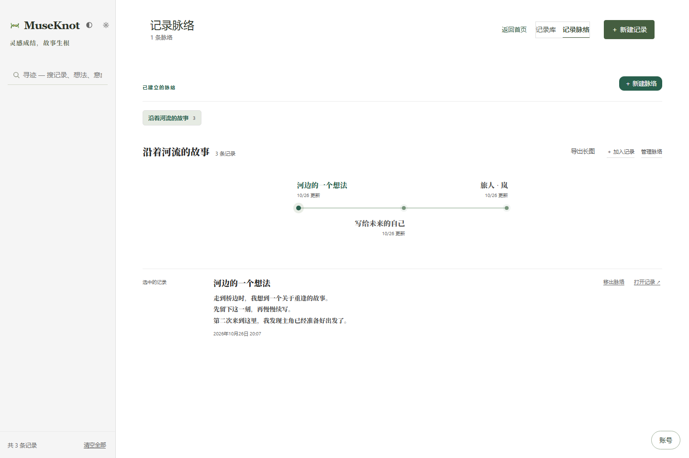
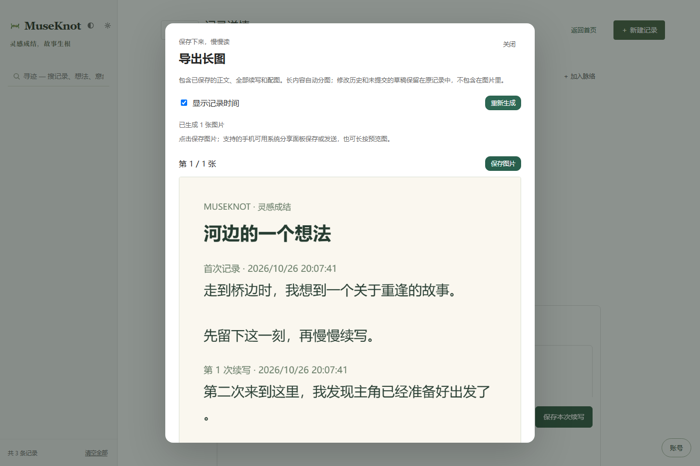

# MuseKnot

**Capture a passing thought. Leave room to continue it.**

MuseKnot is a self-hosted personal writing PWA for ideas, journals, prose and character notes. Keep adding independent entries to a note over time, connect related notes into ordered threads, and export saved content as long images.

**[Try MuseKnot online](https://49.233.131.211/museknot/#invite=579dff2e57dda58ad10435fd213462b9e78ebd2205d87a50)** · [Feedback and issues](https://github.com/ZMX-a/MuseKnot/issues)

The invitation is filled in automatically. Create an account with your email and password to start writing, or sign in with an existing account. Content is stored on the hosted instance and isolated by account. Feedback through GitHub Issues is optional.

[中文说明](README.md) · [Self-hosting](docs/SELF_HOSTING.md) · [Architecture](docs/ARCHITECTURE.md) · [Contributing](CONTRIBUTING.md)



*An example of a user-selected background, with the account email removed. New accounts start with a plain white homepage. The photograph shown here is not a bundled default background and is not licensed under the source-code MIT license.*

## What is it for?

Some writing grows over days or months: a thought you revisit, a diary you keep adding to, a character whose story is still taking shape. MuseKnot keeps those additions together without replacing the earlier entries.

**Capture → Continue → Connect → Export.**

- Capture a short thought, a dream, a picture or a piece of prose.
- Continue the same note later, with separate entries and edit history.
- Arrange related notes into a thread in your preferred reading order.
- Save a note or an entire thread as long images, including saved entries and pictures.

## Using the app

1. Choose **＋ 记录** on the homepage to write a note. A custom name is optional.
2. Open **我的笔记** to find a note and continue writing. Existing entries can be edited with history retained.
3. Use **记录脉络** to connect related notes and arrange their order. Connections reference note IDs and do not merge or rewrite their content.
4. Choose **导出长图** to preview and save an image. Long content splits automatically; timestamps can be hidden.
5. Open **账号 → 首页背景** to choose PNG, JPEG or WebP (up to 8 MB), or restore the plain white default.

Other features include search and tags, invite-only registration, recovery codes, 30-day login sessions, account isolation, mobile layout, and PWA installation. File sharing is available where the browser supports it.

## Screenshots

| Library | Independent entries and history |
|---|---|
|  |  |

| Ordered threads | Long-image export |
|---|---|
|  |  |

[Plain homepage](docs/screenshots/home.png) · [Background settings](docs/screenshots/background.png) · [Mobile layout](docs/screenshots/mobile.png)

## Run locally

You can use the hosted instance linked above or run your own copy on a computer or server. GitHub hosts the source code. The complete application needs its Node.js API and SQLite database; GitHub Pages alone cannot provide them.

Requires **Node.js 22.23.2+ or 24.x** and npm. No separate database installation is needed.

```bash
git clone https://github.com/ZMX-a/MuseKnot.git
cd MuseKnot
npm ci
npm run setup
npm run build
npm start
```

Open the invitation link printed by setup to create the first account, or visit <http://127.0.0.1:4173/museknot/>. Setup creates a local `.env` with a random invitation code only when no configuration exists. Passwords require at least 12 characters; ordinary login needs only email and password.

To try synthetic content, leave the server running and execute this in another terminal:

```bash
npm run demo
```

Sign in as `demo@example.test` with `demo-only-password-2026`. This account is for local development only. The seeding script refuses non-local or non-development targets and does not overwrite existing demo records.

## Phone and PWA use

Production deployment needs valid HTTPS. Install from a supported Android browser or use **Add to Home Screen** in Safari on iPhone/iPad. Installation, saving and sharing behavior varies by browser; the standalone window may need an initial login.

**This release requires a network connection to read and submit records.** The service worker supplies a generic offline page, caches no private responses, notes or images, and does not force a refresh while editing. Full offline editing and synchronization are future work.

See [self-hosting](docs/SELF_HOSTING.md) for server configuration, persistent data, backups and updates.

## Implementation and checks

React 18 + htm and esbuild provide the frontend. A single Node.js HTTP service serves the frontend and API, with built-in `node:sqlite` storage. Notes contain independent entries and edit history; threads store ordered note IDs. The repository also retains D3 / Three.js connection and spatial-view code.

```bash
npm run build
npm test
```

Checks cover record migration, continuations, history, account isolation, local imports, thread order, long-image layout, PWA, names and backgrounds. GitHub Actions runs builds and checks on Node 22 and 24; see [Actions](https://github.com/ZMX-a/MuseKnot/actions) for actual results.

Read [architecture](docs/ARCHITECTURE.md) for implementation details and tradeoffs.

## Data and assets

Notes, pictures and uploaded backgrounds are account-scoped and stored on the deployment's server. Open-sourcing the application does not upload them to GitHub. Data is stored as plaintext on the server, **not end-to-end encrypted**. Protect the database and backups; see [security](SECURITY.md).

Source code and original project icons use the [MIT license](LICENSE). The first screenshot was supplied for documentation and edited to remove the account email; other previews use synthetic records. The third-party photograph in that screenshot is outside the source-code license. No standalone copy is bundled as an application background asset. Upload only images you have the right to use. See [third-party notices](THIRD_PARTY_NOTICES.md).

Resetting a background removes the setting; previously uploaded images remain in the private database and existing backups.

## What's next?

Ongoing work focuses on phone input, image saving, data export and deployment. Full offline editing, synchronization status and conflict handling are planned.

[Report a problem](https://github.com/ZMX-a/MuseKnot/issues), describe a specific use case, or contribute a change. Include reproduction steps and leave private notes, databases, invitation codes and recovery codes out of issues. See [contributing](CONTRIBUTING.md).
